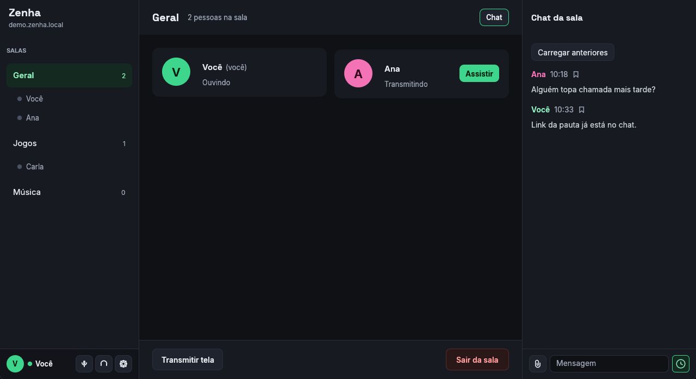
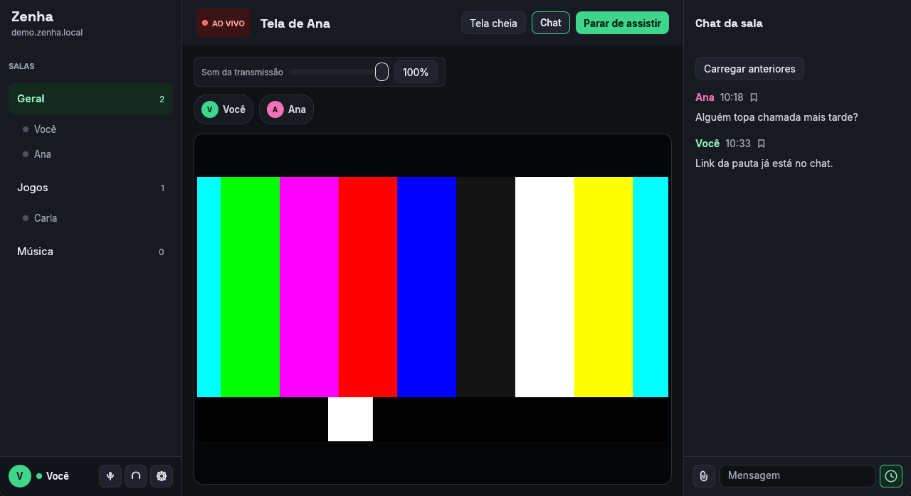
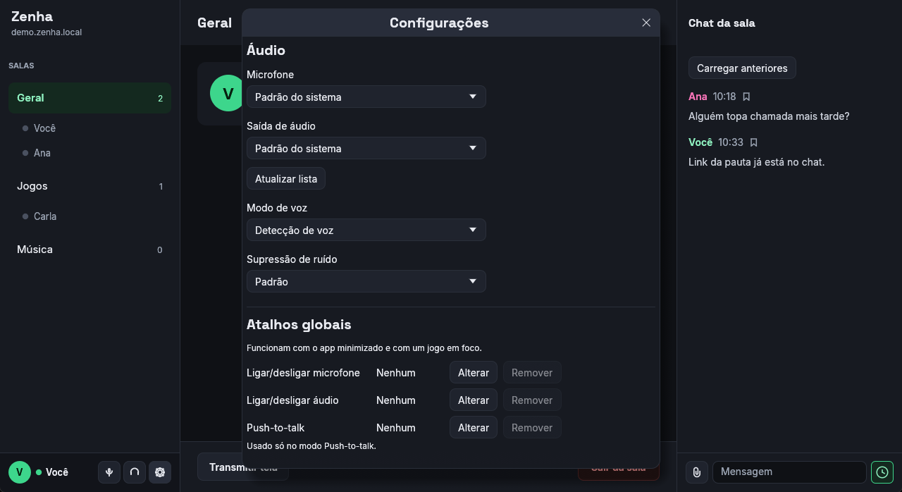
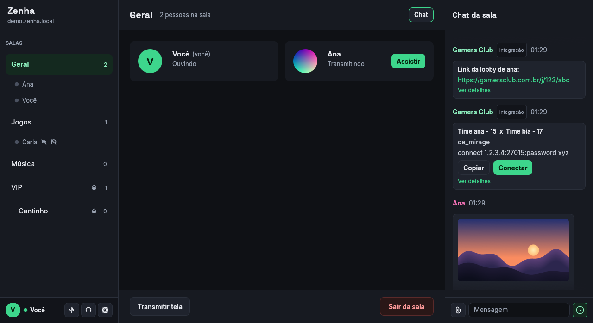
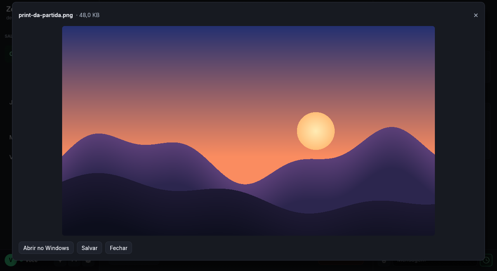

# Zenha

Zenha is a Windows desktop app for voice rooms, text chat, file sharing and screen sharing among a small group of friends. Media goes through a self-hosted [LiveKit](https://github.com/livekit/livekit) SFU; everything else in this repository is Rust.

> The public docs are in English. The app UI is in Brazilian Portuguese.



| Watching a screen share | Settings |
| --- | --- |
|  |  |
| **Gamers Club cards and an image in the chat** | **Image viewer** |
|  |  |

<sub>Screenshots from `zenha --demo`.</sub>

## Features

- **Voice rooms**: live occupant lists, active-speaker highlight, mute and deafen (visible to everyone, in every room), device selection, automatic reconnection.
- **Noise suppression**: Off, WebRTC default, Enhanced (RNNoise) or Strong (RNNoise plus WebRTC suppression), optional echo cancellation, plus a noise gate (on by default) with a level meter.
- **Hotkeys**: global mute, deafen and push-to-talk, with audio cues.
- **Screen sharing**: a monitor or window at 720p30, 1080p30 or 1080p60, captured and H.264-encoded on the GPU, with per-app or system audio and a viewer volume slider.
- **Chat and files**: room chat with unread badge, image thumbnails and viewer, saved messages and file transfers up to 50 MB.
- **Gamers Club integration**: each user gets a personal webhook URL in Settings that posts lobby links and match cards to whichever room they are currently in (admins can also create room webhooks), with buttons to copy the connect command or join the server through Steam.
- **Invites and tray**: `zenha://` invite links, passwords in Windows Credential Manager, minimize to tray without leaving the call.
- **Admin** (optional): manage rooms, mute, stop shares, kick and rotate the invite code.

## Download

Get the latest build from [GitHub Releases](https://github.com/Pedroklg/zenha/releases):

- `Zenha-<version>-windows-x64-setup.exe`: per-user install in `%LOCALAPPDATA%\Programs\Zenha` (no admin rights), Start Menu shortcut, `zenha://` protocol.
- `Zenha-<version>-windows-x64.zip`: portable, extract and run `zenha.exe`.

The binaries are not code-signed yet, so SmartScreen shows "Windows protected your PC" on first launch. Click **More info**, then **Run anyway**.

Settings live in `%APPDATA%\zenha` and survive uninstall. Server passwords live in Windows Credential Manager.

### When it does not open

- Logs of the last runs are in `%LOCALAPPDATA%\zenha\logs`, one file per run.
- **Zenha (diagnostico)** in the Start Menu (or `zenha.exe --diagnostico`) saves `zenha-diagnostico.txt` on the Desktop: app version, Windows, GPU and audio devices, running `zenha.exe` processes, recent crash entries from the Event Viewer and the tail of the last logs. No passwords.
- `zenha.exe --debug` logs in more detail. To watch it live in PowerShell: `& "$env:LOCALAPPDATA\Programs\Zenha\zenha.exe" --debug | Out-Host`.

## Self-hosting

The server is `livekit-server` plus `zenha-server` behind Caddy, run with Docker Compose. See the [deployment guide](docs/deploy.md).

## Building from source

Requirements:

- Windows 10 or 11 (x64); the target is `x86_64-pc-windows-msvc`
- [rustup](https://rustup.rs) (the toolchain in [rust-toolchain.toml](rust-toolchain.toml) installs itself)
- Visual Studio Build Tools with "Desktop development with C++"
- A `livekit-server` binary for local media tests

```powershell
Copy-Item .env.example .env
cargo ci
livekit-server --dev
cargo server
cargo client            # uses the local token server; no media without livekit-server
cargo client -- --demo  # simulated rooms and participants, no server needed
```

| Command | What it does |
| --- | --- |
| `cargo ci` | Boundary checks, `fmt --check`, clippy (`-D warnings`), workspace tests and `cargo deny` |
| `cargo lint` | Clippy on all workspace targets |
| `cargo server` | Runs `zenha-server` |
| `cargo client` | Runs the `zenha` desktop client |
| `cargo fmt --all` | Formats the workspace |

`cargo run -p zenha-server -- hash-password` reads a password from stdin and prints the Argon2 hash for `ZENHA_INVITE_CODE_HASH`.

`scripts\package.cmd` builds the release zip into `dist\`, and the installer too when Inno Setup 6 is installed. Releases are published from a PC with `scripts\release.cmd`; see [Releases and updates](docs/deploy.md#6-releases-and-updates).

## Architecture

The `egui` UI (`zenha-client`) talks to the media engine (`zenha-core`) only through `Command` and `Event` channels, so the UI thread never blocks. `zenha-core` is the only crate that uses the LiveKit SDK. `zenha-server` checks the invite code, issues short-lived room tokens and stores rooms and saved chat messages in SQLite.

See [docs/architecture.md](docs/architecture.md) for diagrams and [docs/adr/](docs/adr/) for decision records.

| Path | Contents |
| --- | --- |
| [`crates/zenha-protocol`](crates/zenha-protocol/README.md) | Shared `serde` types and size limits |
| [`crates/zenha-core`](crates/zenha-core/README.md) | Session, audio, noise suppression, capture and video; the only LiveKit SDK user |
| [`crates/zenha-client`](crates/zenha-client/README.md) | Desktop UI (`zenha.exe`), `eframe`/`egui` |
| [`crates/zenha-server`](crates/zenha-server/README.md) | HTTP server: invite check, LiveKit tokens, rooms, saved chat, admin |
| [`crates/zenha-e2e`](crates/zenha-e2e/README.md) | End-to-end harness with scripted bots and a WASAPI loopback probe |
| `xtask` | `cargo ci`, review checks, icon generation |
| [`deploy`](deploy/README.md) | Server config and OpenTofu infrastructure |
| `installer` | Inno Setup script |
| `docs` | Architecture, deployment, standards and ADRs |

`CLAUDE.md` files at the root and in each crate are short guides for AI coding agents.

## Contributing and security

- [CONTRIBUTING.md](CONTRIBUTING.md): conventions, crate boundaries, commits, manual testing.
- [SECURITY.md](SECURITY.md): how to report a vulnerability.

## License

MIT or Apache-2.0, at your option: [LICENSE-MIT](LICENSE-MIT), [LICENSE-APACHE](LICENSE-APACHE).
