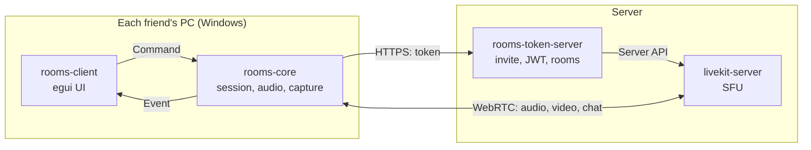

# Architecture

## Components

| Component | Responsibility | Does not handle |
| --- | --- | --- |
| `rooms-client` | Window, screens, room list, chat, video rendering | Networking, LiveKit SDK |
| `rooms-core` | LiveKit session, microphone, screen capture, game audio, hotkeys | UI |
| `rooms-protocol` | JSON types shared between client and token server | I/O |
| `rooms-token-server` | Validates invite code, issues JWT, lists rooms | Media |
| `livekit-server` | Receives each track once and forwards it | App logic |

## Audio Flow

1. The SDK's `PlatformAudio` (or WASAPI capture + RNNoise/DeepFilterNet in Enhanced/Maximum modes) captures the microphone, applies processing, and encodes to Opus.
2. LiveKit forwards the track to the other participants without transcoding.
3. On each receiver, the SDK decodes, mixes, and plays it back.

## Video Flow

1. A `FrameSource` captures the screen or window.
2. `rooms-core` converts the frame to I420 and pushes it to the track; the SDK encodes it.
3. LiveKit forwards it only to participants who subscribed to that stream.
4. On the receiver, `rooms-core` keeps the latest frame and the UI draws it onto a `wgpu` texture.

## Client Threads

| Thread | Responsibility | Rule |
| --- | --- | --- |
| UI | Draws frames and polls events on every frame | Never blocks or performs I/O |
| Tokio runtime | Session, networking, chat, file transfers | Communicates with the UI only via channels |
| Capture | Delivers video frames | Drops late frames |
| SDK audio | Microphone and playout | Managed by `libwebrtc` |
