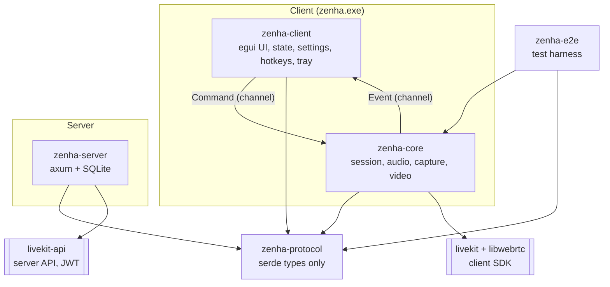
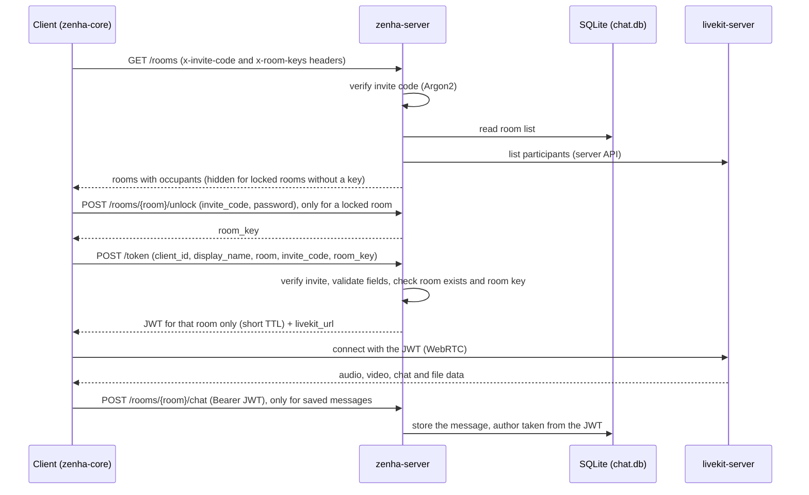

# Architecture

Each friend runs `zenha.exe` on Windows. One small server runs `livekit-server` (the SFU that forwards audio, video and data) and `zenha-server` (invite check, tokens, rooms, saved chat).

## Crates and boundaries

- Only `zenha-core` depends on `livekit` and `libwebrtc`, and no SDK type appears in its public API. `cargo ci` checks this.
- `zenha-client` never imports `livekit`. It sends `Command`s and polls `Event`s through `SessionHandle`; the UI thread never blocks or does I/O.
- `zenha-protocol` holds the JSON types and `MAX_*` limits shared by client and server. No I/O, no async.
- `zenha-server` uses `livekit-api` only to sign tokens and call the LiveKit server API (list participants, moderation, data messages).
- Screen capture sits behind the `FrameSource` trait, so the capturer can change without touching the rest.

| Component | Does | Does not |
| --- | --- | --- |
| `zenha-client` | Window, screens, room list, chat, video display, settings, hotkeys, tray | Networking, LiveKit SDK |
| `zenha-core` | LiveKit session, token client, microphone, noise suppression, screen and game audio capture, file transfers | UI |
| `zenha-protocol` | Shared request/response types and validation | I/O |
| `zenha-server` | Invite check (Argon2), room JWTs, room list, saved chat, admin routes | Media |
| `livekit-server` | Receives each track once and forwards it to subscribers | App logic |

## Joining a room

- The invite code is checked against `ZENHA_INVITE_CODE_HASH`, or against a hash rotated by an admin and kept in SQLite.
- The token's identity is the `client_id`, its name is the trimmed display name, and it grants only the requested room.
- A room can have a password (Argon2 hash in SQLite) and one parent room; nesting is one level deep. `POST /rooms/{room}/unlock` checks the password (rate-limited) and returns a `room_key`: HMAC-SHA256 over the room name and its password hash, keyed with the LiveKit API secret. The parent's password and key also open its children. Changing a password changes the hash, so old keys stop working.
- The client stores keys, never passwords, in `settings.json` per server and room. It sends them in the `x-room-keys` header (`room=key,...`) of `GET /rooms` and in `room_key` of `POST /token`. Without a valid key, `GET /rooms` returns the room's name, count and `locked` flag but no occupants, and `POST /token` answers `403 room_locked`. The invite code is still required for every route.
- Chat messages go over LiveKit data. Only messages a user marks as saved reach the token server; history is read back with `GET /rooms/{room}/chat`.
- Files go over LiveKit byte streams, up to 50 MB, and never touch the token server.
- Profile photos go to `PUT /avatar` (Bearer JWT). The server re-encodes them as 128x128 PNG in the same database and serves them with `GET /avatar/{identity}?v=<version>`. The version travels in the `zenha.avatar` participant attribute, and clients cache each version on disk.
- The same database stores the rooms (seeded once from `ZENHA_ROOM_LIST`) and the rotated invite hash.
- Admin routes (`/admin/*`) exist only when `ZENHA_ADMIN_CODE_HASH` is set; otherwise they return `404`.

## Audio

1. The microphone is captured by the SDK's platform audio (Off and WebRTC default modes) or by WASAPI plus RNNoise or DeepFilterNet (Enhanced and Maximum modes), then encoded to Opus.
2. LiveKit forwards the track without transcoding.
3. Each receiver decodes, mixes and plays it.

Game audio for a share comes from a per-process or system WASAPI loopback and is published as a separate track.

## Video

1. On Windows the share stays on the GPU (`gpu_share`): Windows Graphics Capture grabs the monitor or window, the D3D11 video processor scales it and converts it to NV12, and a Media Foundation hardware H.264 encoder (AMD, NVIDIA or Intel) produces the stream, published as pre-encoded video. A small BGRA copy feeds the sharer's preview. A window resize rebuilds the pipeline on the same device.
2. If the GPU path fails to start, or `ZENHA_GPU_SHARE=0` is set, a `FrameSource` captures on the CPU, `zenha-core` converts the frame to I420 and the SDK encodes it with VP9.
3. LiveKit forwards the track only to participants watching that share.
4. The receiver keeps only the latest frame (`FrameSlot`) and the UI uploads it to an `egui` texture.

## Client threads

| Thread | Does | Rule |
| --- | --- | --- |
| UI | Draws frames and reads pending events every frame | Never blocks or does I/O |
| Tokio runtime | Session, networking, chat, file transfers | Talks to the UI only through channels |
| Capture | Produces video frames (GPU share: captures, converts and encodes) | Drops late frames |
| WASAPI capture | Microphone (Enhanced/Maximum) and share audio | Fixed 10 ms frames |
| SDK audio | Microphone and playout in the default modes | Managed by `libwebrtc` |

Server-side deployment is described in [deploy.md](deploy.md).
