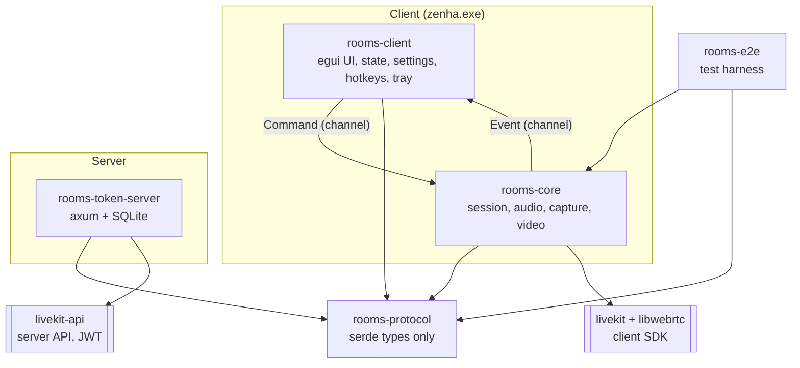
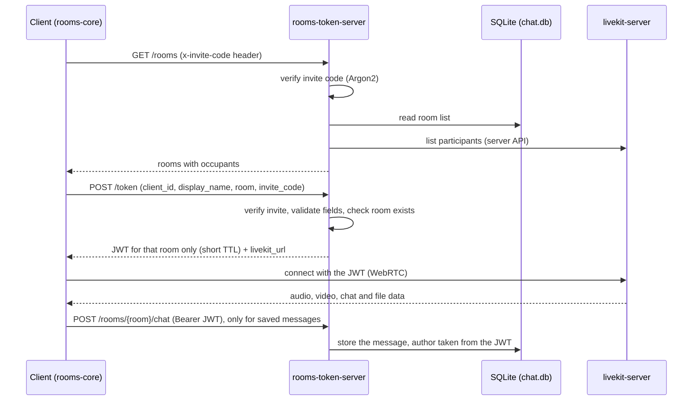

# Architecture

Each friend runs `zenha.exe` on Windows. One small server runs `livekit-server` (the SFU that forwards audio, video and data) and `rooms-token-server` (invite check, tokens, rooms, saved chat).

## Crates and boundaries

- Only `rooms-core` depends on `livekit` and `libwebrtc`, and no SDK type appears in its public API. `cargo ci` checks this.
- `rooms-client` never imports `livekit`. It sends `Command`s and polls `Event`s through `SessionHandle`; the UI thread never blocks or does I/O.
- `rooms-protocol` holds the JSON types and `MAX_*` limits shared by client and server. No I/O, no async.
- `rooms-token-server` uses `livekit-api` only to sign tokens and call the LiveKit server API (list participants, moderation, data messages).
- Screen capture sits behind the `FrameSource` trait, so the capturer can change without touching the rest.

| Component | Does | Does not |
| --- | --- | --- |
| `rooms-client` | Window, screens, room list, chat, video display, settings, hotkeys, tray | Networking, LiveKit SDK |
| `rooms-core` | LiveKit session, token client, microphone, noise suppression, screen and game audio capture, file transfers | UI |
| `rooms-protocol` | Shared request/response types and validation | I/O |
| `rooms-token-server` | Invite check (Argon2), room JWTs, room list, saved chat, admin routes | Media |
| `livekit-server` | Receives each track once and forwards it to subscribers | App logic |

## Joining a room

- The invite code is checked against `ROOMS_INVITE_CODE_HASH`, or against a hash rotated by an admin and kept in SQLite.
- The token's identity is the `client_id`, its name is the trimmed display name, and it grants only the requested room.
- Chat messages go over LiveKit data. Only messages a user marks as saved reach the token server; history is read back with `GET /rooms/{room}/chat`.
- Files go over LiveKit byte streams, up to 50 MB, and never touch the token server.
- The same database stores the rooms (seeded once from `ROOMS_ROOM_LIST`) and the rotated invite hash.
- Admin routes (`/admin/*`) exist only when `ROOMS_ADMIN_CODE_HASH` is set; otherwise they return `404`.

## Audio

1. The microphone is captured by the SDK's platform audio (Off and WebRTC default modes) or by WASAPI plus RNNoise or DeepFilterNet (Enhanced and Maximum modes), then encoded to Opus.
2. LiveKit forwards the track without transcoding.
3. Each receiver decodes, mixes and plays it.

Game audio for a share comes from a per-process or system WASAPI loopback and is published as a separate track.

## Video

1. A `FrameSource` captures a monitor or window.
2. `rooms-core` converts the frame to I420 and pushes it to the track; the SDK encodes it.
3. LiveKit forwards it only to participants watching that share.
4. The receiver keeps only the latest frame (`FrameSlot`) and the UI uploads it to an `egui` texture.

## Client threads

| Thread | Does | Rule |
| --- | --- | --- |
| UI | Draws frames and reads pending events every frame | Never blocks or does I/O |
| Tokio runtime | Session, networking, chat, file transfers | Talks to the UI only through channels |
| Capture | Produces video frames | Drops late frames |
| WASAPI capture | Microphone (Enhanced/Maximum) and share audio | Fixed 10 ms frames |
| SDK audio | Microphone and playout in the default modes | Managed by `libwebrtc` |

Server-side deployment is described in [deploy.md](deploy.md).
