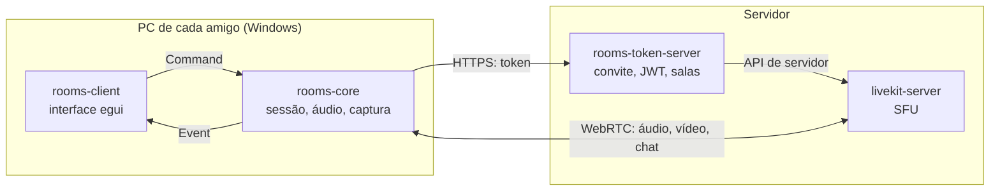

# Arquitetura

## Componentes

| Componente | Responsabilidade | Não faz |
| --- | --- | --- |
| `rooms-client` | Janela, telas, lista de salas, chat, desenho do vídeo | Rede, SDK do LiveKit |
| `rooms-core` | Sessão LiveKit, microfone, captura, áudio do jogo, atalhos | Interface |
| `rooms-protocol` | Tipos JSON entre cliente e servidor de tokens | I/O |
| `rooms-token-server` | Valida convite, emite JWT, lista salas | Mídia |
| `livekit-server` | Recebe cada track uma vez e redistribui | Lógica do app |

## Fluxo de áudio

1. O `PlatformAudio` do SDK captura o microfone, aplica cancelamento de eco e supressão de ruído e codifica em Opus.
2. O LiveKit encaminha a track para os outros participantes, sem decodificar.
3. Em cada receptor, o SDK decodifica, mistura e toca.

## Fluxo de vídeo

1. Um `FrameSource` captura a tela ou a janela.
2. A `rooms-core` converte para I420 e empurra o frame na track; o SDK codifica.
3. O LiveKit encaminha só para quem assinou aquela transmissão.
4. No receptor, a `rooms-core` guarda o frame mais recente e a interface o desenha em uma textura `wgpu`.

## Threads no cliente

| Thread | Faz | Regra |
| --- | --- | --- |
| Interface | Desenha e lê eventos a cada frame | Nunca bloqueia nem faz I/O |
| Runtime Tokio | Sessão, rede, chat | Fala com a interface só por canais |
| Captura | Entrega frames | Descarta frame atrasado |
| Áudio do SDK | Microfone e reprodução | Gerenciada pelo `libwebrtc` |
