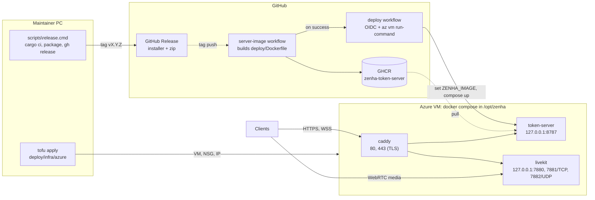

# Deploying the server

This guide runs `livekit-server`, `zenha-server` and Caddy on one Azure Linux VM, provisioned with OpenTofu, with DNS on Cloudflare and updates through GitHub Actions. A Hetzner Cloud stack is in [`deploy/infra/hetzner/`](../deploy/infra/hetzner/).

Commands are bash (Git Bash or WSL on Windows) unless marked PowerShell. In Git Bash, set `MSYS_NO_PATHCONV=1` so Azure resource IDs such as `/subscriptions/...` are not rewritten as Windows paths. Replace `voice.example.com`, `rtc.voice.example.com`, `<owner>` and `<public-ip>` with your values.

## Overview



- **VM**: `Standard_B2ats_v2` (2 vCPU, 1 GiB), Ubuntu 24.04 LTS, 30 GiB Standard SSD, static Standard public IPv4, region `chilecentral` by default.
- **Containers** ([`deploy/docker-compose.yml`](../deploy/docker-compose.yml), host networking): `livekit/livekit-server:v1.13.11`, `ghcr.io/<owner>/zenha-token-server:<tag>`, `caddy:2.11.9-alpine`. Caddy serves `TOKEN_DOMAIN` from `127.0.0.1:8787` and `RTC_DOMAIN` from `127.0.0.1:7880`.
- **Secrets**: the LiveKit key and secret and the Argon2 hashes (`ZENHA_INVITE_CODE_HASH`, optional `ZENHA_ADMIN_CODE_HASH`) exist only on the VM, in `/opt/zenha/.env` and `/opt/zenha/livekit.yaml` (mode `0600`). CI only changes `ZENHA_IMAGE` and restarts the stack.
- **Inbound ports** (NSG):

| Port | Use |
| --- | --- |
| `80/TCP` | ACME HTTP-01 and redirect to HTTPS |
| `443/TCP` | Token server (HTTPS) and LiveKit signaling (WSS) |
| `7881/TCP` | WebRTC ICE over TCP |
| `7882/UDP` | WebRTC media (single UDP port) |
| `22/TCP` | Closed unless `ssh_allowed_cidr` is set |

## 1. Prerequisites

1. An Azure subscription (Azure for Students works) that can deploy in `chilecentral`.
2. Azure CLI 2.60+ and [OpenTofu](https://opentofu.org/) 1.6+ (`az version`, `tofu version`).
3. A Cloudflare DNS zone for your domain.
4. An SSH key for the VM admin account:
   ```bash
   ssh-keygen -t ed25519 -C "zenha-azure" -f ~/.ssh/zenha_azure
   ```
5. A token server image on GHCR. Push a `vX.Y.Z` tag or run **Actions > server-image > Run workflow** with a `vX.Y.Z` tag. Then open the `zenha-token-server` package, **Package settings > Change visibility > Public**, so the VM can pull it without a registry token.

## 2. Provision the VM

The stack lives in [`deploy/infra/azure`](../deploy/infra/azure/README.md). It also covers adopting resources created by the old Bicep templates.

1. Log in and select the subscription:
   ```bash
   az login
   az account set --subscription "<subscription-id>"
   export ARM_SUBSCRIPTION_ID="<subscription-id>"
   ```
   PowerShell: `$env:ARM_SUBSCRIPTION_ID = "<subscription-id>"`.
2. Create the resource group:
   ```bash
   az group create --name zenha-rg --location chilecentral
   ```
3. Copy `deploy/infra/azure/terraform.tfvars.example` to `terraform.tfvars` (gitignored) and set:
   - `ssh_public_key`: the contents of `~/.ssh/zenha_azure.pub`
   - `dns_label_prefix`: a globally unique label (`<label>.chilecentral.cloudapp.azure.com`)
   - `ssh_allowed_cidr`: `""` keeps SSH closed, or `"<your-ip>/32"`
4. Apply and read the outputs (`public_ip_address`, `fqdn`, `vm_name`):
   ```bash
   cd deploy/infra/azure
   tofu init
   tofu plan
   tofu apply
   tofu output
   ```
5. On first boot, cloud-init ([`deploy/infra/modules/host/cloud-init.yaml`](../deploy/infra/modules/host/cloud-init.yaml)) installs Docker, the Compose plugin and `unattended-upgrades`, and creates `/opt/zenha`. Wait for it:
   ```bash
   az vm run-command invoke --resource-group zenha-rg --name zenha-vm \
     --command-id RunShellScript --scripts "cloud-init status --wait"
   ```

## 3. DNS

In Cloudflare, create two `A` records pointing to `public_ip_address`, both **DNS only (grey cloud)**, TTL Auto:

| Name | Example |
| --- | --- |
| Token server | `voice` |
| LiveKit | `rtc.voice` |

The Cloudflare proxy must stay off: it does not forward `7881/TCP` and `7882/UDP`, and Caddy needs ports 80 and 443 for Let's Encrypt. Check propagation before the next step so Caddy gets certificates right away:

```bash
nslookup voice.example.com 1.1.1.1
nslookup rtc.voice.example.com 1.1.1.1
```

## 4. Bootstrap the server

[`deploy/setup-server.sh`](../deploy/setup-server.sh) runs once as root on the VM and is safe to rerun. It installs `docker-compose.yml` and `Caddyfile` into `/opt/zenha`, generates the LiveKit key pair (or keeps the existing one), takes the Argon2 hashes (or hashes plaintext passwords with `zenha-server hash-password`), writes `/opt/zenha/livekit.yaml` and `/opt/zenha/.env` with mode `0600`, runs `docker compose pull && docker compose up -d` and checks `http://127.0.0.1:8787/health`.

Generate the hashes on your PC so plaintext passwords never reach Azure logs:

```bash
echo "your-invite-password" | cargo run --quiet -p zenha-server -- hash-password
# Optional; without it /admin/* returns 404:
echo "your-admin-password"  | cargo run --quiet -p zenha-server -- hash-password
```

**Without SSH.** `run-command` does not pass `KEY=value` arguments, so prepend the settings to a copy of the script. Keep the shebang on line 1: without it the script runs under `sh`, which rejects `set -o pipefail`.

```bash
{
  echo '#!/usr/bin/env bash'
  echo "export TOKEN_DOMAIN='voice.example.com'"
  echo "export RTC_DOMAIN='rtc.voice.example.com'"
  echo "export ZENHA_IMAGE='ghcr.io/<owner>/zenha-token-server:v0.1.0'"
  echo 'export ZENHA_INVITE_CODE_HASH='\''$argon2id$v=19$m=19456,t=2,p=1$...'\'
  # Optional: enable /admin/*
  echo 'export ZENHA_ADMIN_CODE_HASH='\''$argon2id$v=19$m=19456,t=2,p=1$...'\'
  # Optional: pin the public IP instead of STUN discovery
  # echo "export NODE_IP='<public-ip>'"
  tail -n +2 deploy/setup-server.sh
} > /tmp/zenha-setup.sh

az vm run-command invoke --resource-group zenha-rg --name zenha-vm \
  --command-id RunShellScript --scripts @/tmp/zenha-setup.sh \
  --query 'value[0].message' -o tsv
rm /tmp/zenha-setup.sh
```

By default `livekit.yaml` gets `use_external_ip: true`, so LiveKit finds the public IP through STUN across Azure's 1:1 NAT. With `NODE_IP` set it writes `use_external_ip: false` and `node_ip: "<public-ip>"` instead.

**Over SSH** (needs `ssh_allowed_cidr`):

```bash
scp -i ~/.ssh/zenha_azure deploy/setup-server.sh deploy/docker-compose.yml deploy/Caddyfile azureuser@<public-ip>:/tmp/
ssh -i ~/.ssh/zenha_azure azureuser@<public-ip> \
  "sudo TOKEN_DOMAIN=voice.example.com RTC_DOMAIN=rtc.voice.example.com ZENHA_IMAGE=ghcr.io/<owner>/zenha-token-server:v0.1.0 bash /tmp/setup-server.sh"
```

Run in a terminal without `ZENHA_INVITE_CODE_HASH`, the script asks silently for the hash or the plaintext invite password.

## 5. GitHub Actions deploy (OIDC)

[`.github/workflows/deploy.yml`](../.github/workflows/deploy.yml) logs in to Azure with OpenID Connect (`azure/login@v3`), with no long-lived secret, in the `production` environment.

1. Create the app registration and give it `Virtual Machine Contributor` on the VM only:
   ```bash
   SUBSCRIPTION_ID="$(az account show --query id -o tsv)"
   TENANT_ID="$(az account show --query tenantId -o tsv)"
   RG_NAME="zenha-rg"
   VM_NAME="zenha-vm"
   GH_OWNER="<github-owner>"
   GH_REPO="<github-repo>"

   APP_ID="$(az ad app create --display-name "github-zenha-deploy" --query appId -o tsv)"
   az ad sp create --id "${APP_ID}"
   az role assignment create \
     --assignee "${APP_ID}" \
     --role "Virtual Machine Contributor" \
     --scope "/subscriptions/${SUBSCRIPTION_ID}/resourceGroups/${RG_NAME}/providers/Microsoft.Compute/virtualMachines/${VM_NAME}"
   ```
2. Add the federated credential. The subject is `repo:<owner>/<repo>:environment:production`. Newer repositories may send `repo:<owner>@<owner_id>/<repo>@<repo_id>:environment:production`; if the first deploy fails with `AADSTS700213`, register the subject printed in the error.
   ```bash
   az ad app federated-credential create \
     --id "${APP_ID}" \
     --parameters "{
       \"name\": \"github-production-env\",
       \"issuer\": \"https://token.actions.githubusercontent.com\",
       \"subject\": \"repo:${GH_OWNER}/${GH_REPO}:environment:production\",
       \"description\": \"GitHub Actions production deployment\",
       \"audiences\": [\"api://AzureADTokenExchange\"]
     }"
   ```
3. In **Settings > Environments**, create `production` and add these as variables or secrets:

| Name | Value |
| --- | --- |
| `AZURE_CLIENT_ID` | `${APP_ID}` |
| `AZURE_TENANT_ID` | `${TENANT_ID}` |
| `AZURE_SUBSCRIPTION_ID` | `${SUBSCRIPTION_ID}` |
| `AZURE_RESOURCE_GROUP` | `zenha-rg` |
| `AZURE_VM_NAME` | `zenha-vm` (default if unset) |

### If your tenant blocks app registrations

Some Azure for Students tenants refuse `az ad app create` ("Insufficient privileges"). Update the VM yourself instead.

From your Azure CLI, with SSH still closed:

```bash
az vm run-command invoke --resource-group zenha-rg --name zenha-vm \
  --command-id RunShellScript \
  --scripts '
    set -euo pipefail
    sed -i "s|^ZENHA_IMAGE=.*|ZENHA_IMAGE=$1|" /opt/zenha/.env
    chmod 0600 /opt/zenha/.env
    cd /opt/zenha && docker compose pull && docker compose up -d --remove-orphans
  ' \
  --parameters "ghcr.io/<owner>/zenha-token-server:v0.1.0"
```

Or over SSH, after setting `ssh_allowed_cidr = "<your-ip>/32"` and running `tofu apply`:

```bash
ssh -i ~/.ssh/zenha_azure azureuser@<public-ip> '
  sudo sed -i "s|^ZENHA_IMAGE=.*|ZENHA_IMAGE=ghcr.io/<owner>/zenha-token-server:v0.1.0|" /opt/zenha/.env &&
  cd /opt/zenha &&
  sudo docker compose pull &&
  sudo docker compose up -d --remove-orphans
'
```

## 6. Releases and updates

Releases are built on a Windows PC; GitHub Actions does not build or test the code.

1. Start from a clean `main`. Unless they already match, the script bumps `[workspace.package].version` in `Cargo.toml`, `AppVersion` in `installer/zenha.iss` and `Cargo.lock` on a `release/vX.Y.Z` branch and merges it.
2. On `main`, run (needs `gh` logged in and Inno Setup 6):
   ```powershell
   scripts\release.cmd 0.2.0
   ```
   The script checks that tag `v0.2.0` does not exist, runs `cargo ci`, builds the installer and zip with `scripts\package.cmd` (baking in the repository variable `ZENHA_DEFAULT_SERVER` as the default server and this repository as the update source), pushes `main` and creates tag `v0.2.0` and the GitHub Release.
3. The tag starts `server-image`, which pushes `ghcr.io/<owner>/zenha-token-server:v0.2.0` and `:latest`.
4. When `server-image` succeeds, `deploy` sets `ZENHA_IMAGE` in `/opt/zenha/.env`, runs `docker compose pull && docker compose up -d --remove-orphans` and checks `/health`.

To redeploy or roll back, run **Actions > deploy > Run workflow** with a tag (`v0.2.0` or `latest`).

To update LiveKit or Caddy, change the pinned tags in `deploy/docker-compose.yml` and `deploy/setup-server.sh`, then rerun `setup-server.sh`; it keeps the keys and hashes in `/opt/zenha/.env`.

## 7. Start and stop

The VM stays on all month: Azure for Students covers 750 h/month of `Standard_B2ats_v2`, and a month has at most 744 h. To stop it anyway, or to check it:

```powershell
scripts\server.cmd start
scripts\server.cmd stop
scripts\server.cmd status
```

`stop` deallocates the VM: compute billing stops, the disk and static IP stay, so DNS keeps working. The `deploy` workflow starts a deallocated VM, updates it and deallocates it again.

## 8. Operations

### Health and latency

```bash
curl -sS -o /dev/null -w "dns=%{time_namelookup}s tcp=%{time_connect}s tls=%{time_appconnect}s ttft=%{time_starttransfer}s total=%{time_total}s\n" \
  https://voice.example.com/health
```

`tcp - dns` is the round-trip time to the VM. Azure drops inbound ICMP by default, so use TCP timing instead of `ping`. In PowerShell:

```powershell
Test-NetConnection -ComputerName rtc.voice.example.com -Port 443
Test-NetConnection -ComputerName rtc.voice.example.com -Port 7881
```

### Logs

```bash
az vm run-command invoke --resource-group zenha-rg --name zenha-vm \
  --command-id RunShellScript \
  --scripts "cd /opt/zenha && docker compose logs --tail=100 livekit token-server caddy"
```

### Saved chat database

The token server keeps saved messages, rooms (seeded once from `ZENHA_ROOM_LIST`) and the rotated invite hash in SQLite (WAL mode) at `ZENHA_CHAT_DB`. In production that is `/var/lib/zenha/chat.db` on the Compose volume `zenha_zenha_data`.

- Messages and room titles are stored in **plaintext** with **no expiry**. Unsaved messages never reach the server. Senders delete their own messages with `DELETE /rooms/{room}/chat/{id}`; admins can delete any with `DELETE /admin/rooms/{room}/chat/{id}`.
- Backup to your PC: `scripts\server.cmd backup` (uses `~/.ssh/zenha_azure`, starts the VM if needed, opens SSH to your IP only during the copy, saves to `backups\`). Or back up on the VM while it runs (check the volume name with `docker volume ls`):
  ```bash
  mkdir -p /opt/zenha/backups
  docker run --rm -v zenha_zenha_data:/data -v /opt/zenha/backups:/backup alpine \
    sh -c 'apk add --no-cache sqlite >/dev/null && sqlite3 /data/chat.db ".backup /backup/chat-$(date -u +%Y%m%dT%H%M%SZ).db"'
  ```
- Reset: deletes all saved messages, custom rooms (they reseed from `ZENHA_ROOM_LIST`) and the rotated invite code (back to `ZENHA_INVITE_CODE_HASH`):
  ```bash
  cd /opt/zenha
  docker compose stop token-server
  docker run --rm -v zenha_zenha_data:/data alpine rm -f /data/chat.db /data/chat.db-wal /data/chat.db-shm
  docker compose up -d token-server
  ```

### Admin

Admin routes are off by default: without `ZENHA_ADMIN_CODE_HASH`, every `/admin/*` route returns `404`.

To set or rotate the admin password:

1. Hash it with `echo "password" | cargo run --quiet -p zenha-server -- hash-password`, or on the VM with `docker run --rm -i "$ZENHA_IMAGE" hash-password`.
2. Set `ZENHA_ADMIN_CODE_HASH='$argon2id$...'` in `/opt/zenha/.env` (single quotes, so `$` is not expanded), or rerun `setup-server.sh` with `ADMIN_PASSWORD=...` or `ZENHA_ADMIN_CODE_HASH=...`.
3. Restart: `cd /opt/zenha && docker compose up -d token-server`.

`POST /admin/login` returns an admin JWT (lifetime `ZENHA_TOKEN_TTL_SECS`) with no LiveKit media grants. Failed logins are delayed and rate-limited per `client_id` and per client IP (`X-Forwarded-For` from Caddy). With `Authorization: Bearer <admin_token>` an admin can:

- Create (up to 50), rename, reorder and delete rooms, and set a room's password or parent room: `POST /admin/rooms`, `PATCH` and `DELETE /admin/rooms/{id}`. The last room cannot be deleted; deleting a room removes its LiveKit room and saved chat. Clients get `rooms.changed`.
- Moderate a participant: `POST /admin/rooms/{room}/participants/{identity}/` `mute`, `stop-share` (mutes the share and sends `admin.stop_share`), `kick` or `move` (sends `admin.move` to the client, since LiveKit's `MoveParticipant` is Cloud-only).
- Delete any saved message: `DELETE /admin/rooms/{room}/chat/{id}` (broadcasts `admin.chat_delete`).
- Rotate the invite code: `POST /admin/invite` (8 to 128 characters). The new Argon2 hash is stored in `chat.db` and overrides `ZENHA_INVITE_CODE_HASH`, also across restarts.

## 9. Costs

Azure for Students gives $100 of credit for 12 months. Set a budget alert first.

- **Portal** (recommended): **Cost Management > Budgets > Add**, scope your subscription, name `zenha-monthly-budget`, monthly, `10` USD, alerts at 50%, 80% and 100% (actual and forecasted) to your email.
- **CLI**: may fail with an unsupported offer error on student offers (`MS-AZR-0170P`); use the portal then.
  ```bash
  az consumption budget create \
    --budget-name "zenha-monthly-budget" \
    --category "cost" \
    --amount 10.0 \
    --time-grain "monthly" \
    --start-date "2026-11-01" \
    --end-date "2027-11-01"
  ```

Estimated monthly cost in `chilecentral` (USD, 730 h):

| Resource | Free allowance | Expected charge |
| --- | --- | --- |
| VM `Standard_B2ats_v2` (~$9.64/mo list) | 750 h/month for 12 months | $0 |
| OS disk `StandardSSD_LRS` 30 GiB (billed as E4) | May be covered by the free managed disks | $0 to ~$3 |
| Static Standard public IPv4 ($0.005/h) | None | ~$3.65 |
| VNet, NSG, inbound traffic | Free | $0 |
| Outbound traffic | 15 GB/month | ~$0.12 to $0.16 per extra GB |

That is about $3.65 to $6.65 per month plus egress above 15 GB, so the credit lasts the year. Rough egress: one speaker to five listeners is ~200 kbps (~90 MB/hour, ~165 hours of voice in 15 GB); a 1080p30 share to three viewers is ~7.5 Mbps (~3.4 GB/hour, ~$0.40 to $0.54 per hour past the allowance).

The exact student-offer rates for `chilecentral` and whether the 30 GiB disk is zero-rated could not be confirmed; check **Cost Management > Cost analysis** and **Education Hub > Free services** after a day or two.

Sources: [Azure for Students](https://learn.microsoft.com/en-us/azure/education-hub/azure-for-students-program), [free account FAQ](https://azure.microsoft.com/en-us/free/free-account-faq/), [VM pricing](https://azure.microsoft.com/en-us/pricing/details/virtual-machines/linux/), [managed disks](https://azure.microsoft.com/en-us/pricing/details/managed-disks/), [IP addresses](https://azure.microsoft.com/en-us/pricing/details/ip-addresses/), [bandwidth](https://azure.microsoft.com/en-us/pricing/details/bandwidth/).
